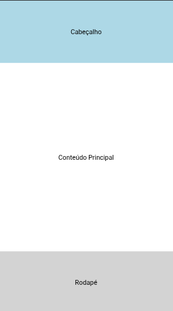

# Exercícios Slide 2

## Objetivo do Exercício

Este projeto demonstra a criação de um layout **responsivo** utilizando **Flexbox** no React Native.  
A tela é dividida em três partes principais:

- **Cabeçalho (Header)** → ocupa 1 parte do espaço  
- **Conteúdo Principal (Content)** → ocupa 3 partes do espaço  
- **Rodapé (Footer)** → ocupa 1 parte do espaço

---

### Resultado dos Exercícios



---

## Tecnologias Utilizadas

- Visual Studio Code  
- Node.js (NPM)  
- React Native (Expo)  
- JavaScript

---

## Como executar o projeto

### 1. Clone o repositório

```bash
git clone https://github.com/d4nkali/UNIESP_Programacao_Dispositivos_Moveis_p5.git
cd UNIESP_Programacao_Dispositivos_Moveis_p5/ExerciciosSlides02
```

### 2. Instale as dependências do projeto React

```bash
npm install
```

### 4. Inicie o projeto React Native

Em outro terminal:

```bash
npm start
```

---

## Estrutura dos Arquivos

```
ExerciciosSlides02/
├─ .expo/
│  ├─ web/
│  │  └─ cache/
│  │     └─ production/
│  │        └─ images/
│  │           └─ favicon/
│  │              └─ favicon-24272cdaeff82cc5facdaccd982a6f05b60c4504704bbf94c19a6388659880bb-contain-transparent/
│  │                 └─ favicon-48.png
│  ├─ devices.json
│  └─ README.md
├─ assets/
│  ├─ adaptive-icon.png
│  ├─ favicon.png
│  ├─ icon.png
│  └─ splash-icon.png
├─ img/
│  └─ exercicios.png
├─ src/
│  └─ components/
│     └─ LayoutResponsivo.js
├─ .gitignore
├─ App.js
├─ app.json
├─ index.js
├─ package-lock.json
├─ package.json
└─ README.md
```

---

## Autor

**Danilo Pereira** – [@d4nkali](https://github.com/d4nkali)
